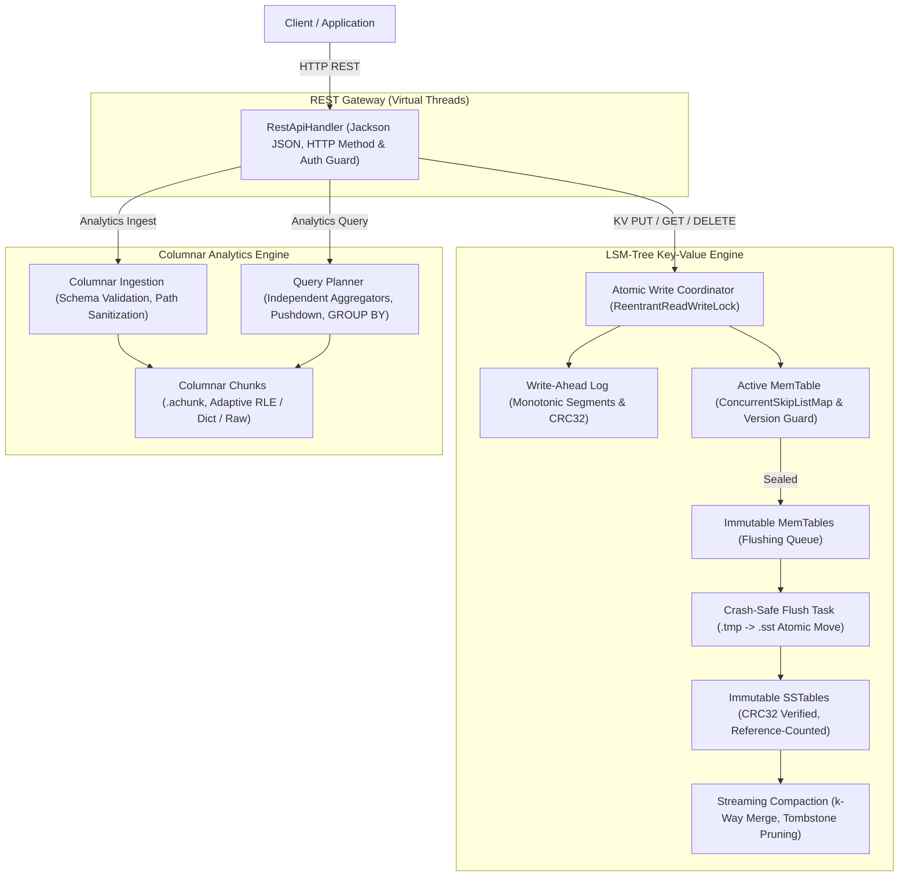

# AetherDB V2 Architecture & Systems Reference

This document details the architectural layout, write/read pipelines, durability guarantees, compaction algorithms, and distributed state machine mechanics of **AetherDB V2**.

---

## 1. Storage Architecture Overview

AetherDB is a hybrid storage engine prototype engineered in modern Java (compiled with Maven `--release 21`), combining a Log-Structured Merge-Tree (LSM) key-value engine with a columnar analytics engine.

---

## 2. Key Engineering Guarantees

### 2.1 Storage Correctness & Durability
- **Monotonic WAL Segments**: Segments are identified by monotonic integer IDs (`wal_%08d.wal`). All segments in the WAL directory are replayed chronologically on restart.
- **Torn-Tail Crash Recovery**: Trailing uncommitted records damaged during power loss are detected at EOF and cleanly truncated to `lastValidOffset`. Corrupted data in the middle of a log halts recovery safely with `CorruptedWalException`.
- **Sequence Number Monotonicity**: Restores maximum sequence number from both WAL segments and all existing SSTables, guaranteeing new commits always receive strictly greater sequence numbers.
- **Atomic Write Ordering**: Sequence allocation, WAL append, and MemTable insertion are serialized atomically, preventing lower-sequence writes from racing ahead of higher-sequence writes.
- **Version-Aware Reads**: Point reads select the record with the strictly highest sequence number across active MemTable, flushing MemTables, and SSTables. Newer tombstones properly hide older values.

### 2.2 SSTable Integrity & Compaction Concurrency
- **CRC32 Verification**: Data blocks and footers verify checksums on deserialization.
- **Atomic Installation**: SSTables and columnar chunks are written to `.tmp` files, synced to disk, and atomically renamed into place.
- **Compaction Isolation**: Compacted SSTables replace only participating tables; concurrent flushes are never clobbered.
- **Streaming Compaction**: Uses a priority-queue streaming merge iterator to de-duplicate keys with constant heap memory usage.

### 2.3 Query & Analytical Integrity
- **Isolated Aggregate Accumulators**: `COUNT(*)`, `COUNT(col)`, `SUM`, `AVG`, `MIN`, and `MAX` maintain independent state per expression. `COUNT(col)` excludes nulls, and `AVG(col)` divides solely by non-null counts.
- **Accurate Boundary Evaluation**: `>=` and `<=` operators and ZoneMap skipping rules include boundary values.
- **GROUP BY Aggregation**: Evaluates group-by keys row-by-row into independent group accumulator maps.

### 2.4 REST Security & Hardening
- **HTTP Method Enforcement**: Strict 405 Method Not Allowed checks.
- **Jackson Core Serialization**: Robust JSON parsing replacing fragile string splitting.
- **Security Guards**: Bounded request payload sizes (10 MB default), configurable Bearer token authentication, and directory traversal rejection on table names.

### 2.5 Distributed Scope
- Raft consensus is documented as an experimental prototype for simulation. Standard KV writes execute on the local storage engine.
- Consistent hashing uses a collision-safe virtual node representation that prevents node overwrite on hash collision.
