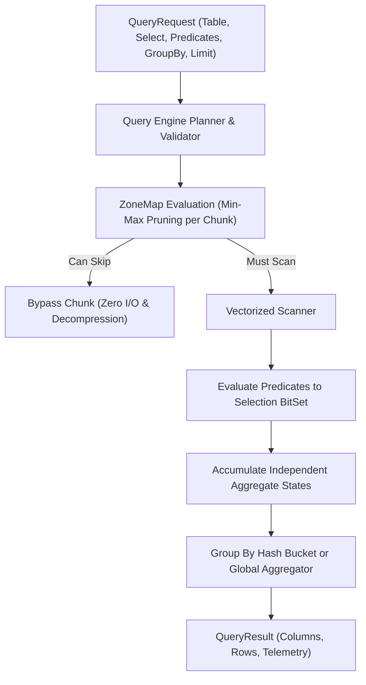

# Vectorized Query & Analytical Engine

## 1. Query Execution Pipeline

AetherDB provides an in-memory columnar query execution engine supporting predicate pushdown, independent aggregation states, inclusive/exclusive boundaries, 64-bit integer precision, and GROUP BY operations.

---

## 2. Independent Aggregate State & Precision Architecture

Every select expression maintains its own dedicated `AggregateAccumulator`:
- **`COUNT(*)`**: Counts all matching rows in the selection bitset.
- **`COUNT(column)`**: Counts only non-null values in the target column.
- **`SUM(column)`**:
  - Accumulates non-null integer types (`INT32`, `INT64`, `TIMESTAMP`) as 64-bit `Long` values using `aggregateSumLong()` and `Math.addExact()`.
  - Preserves exact 64-bit precision without double-precision rounding or precision loss.
  - Switches to double precision floating-point accumulator only upon integer overflow.
  - Floating-point columns (`FLOAT64`) accumulate directly as `Double`.
- **`AVG(column)`**: Accumulates non-null values and divides strictly by the non-null count for that column.
- **`MIN(column)`** / **`MAX(column)`**: Tracks the minimum and maximum non-null values for that column.

### SQL-Standard Empty Results
When querying empty tables, non-existent tables, or queries where no rows match the filter predicates:
- `COUNT(*)` = `0L`
- `COUNT(column)` = `0L`
- `SUM(column)` = `null`
- `AVG(column)` = `null`
- `MIN(column)` = `null`
- `MAX(column)` = `null`

---

## 3. Comparison Operators & Inclusive Boundary Semantics

| Operator | Symbol | Evaluation Semantics | ZoneMap Skip Rule |
| :--- | :--- | :--- | :--- |
| `EQUALS` | `=` | `val == target` | `target < minVal \|\| target > maxVal` |
| `NOT_EQUALS` | `!=` | `val != null && val != target` | `minVal == maxVal == target && nullCount == 0` |
| `GREATER_THAN` | `>` | `val > target` | `maxVal <= target` |
| `GREATER_THAN_OR_EQUALS` | `>=` | `val >= target` (boundary included) | `maxVal < target` |
| `LESS_THAN` | `<` | `val < target` | `minVal >= target` |
| `LESS_THAN_OR_EQUALS` | `<=` | `val <= target` (boundary included) | `minVal > target` |
| `LIKE` | `LIKE` | Case-insensitive regex with `%` and `_` | Scanned |

---

## 4. GROUP BY & Query Validation

When `groupByColumns` are specified in `QueryRequest`:
1. **Strict Expression Validation**: Every expression in the `SELECT` list must either be an aggregate function (`COUNT`, `SUM`, `AVG`, `MIN`, `MAX`) or be explicitly listed in the `GROUP BY` clause. Non-aggregate standalone columns not in the `GROUP BY` list are strictly rejected with an informative error.
2. **Schema Column Verification**: All columns specified in expressions, group-by clauses, and filter predicates are verified against the table schema.
3. **Partitioned Bucketing**: Selected rows are grouped into `LinkedHashMap<GroupKey, List<AggregateAccumulator>>`.
4. Output rows contain `[groupByColumns..., selectExpressions...]`.
