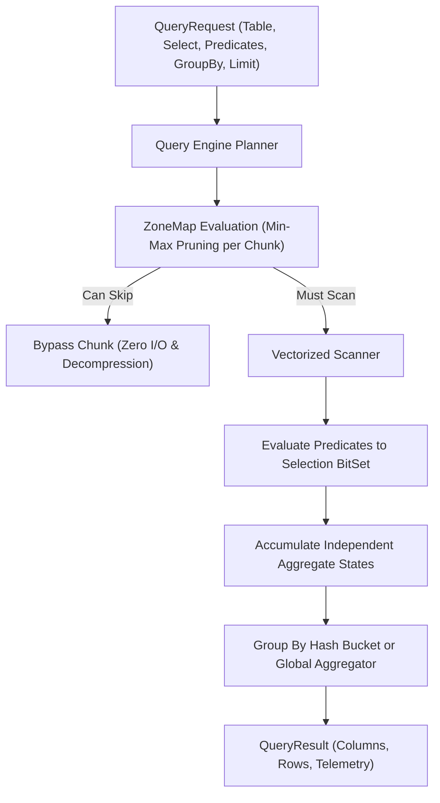

# Vectorized Query & Analytical Engine

## 1. Query Execution Pipeline

AetherDB provides an in-memory columnar query execution engine supporting predicate pushdown, independent aggregation states, inclusive/exclusive boundaries, and GROUP BY operations.

---

## 2. Independent Aggregate State Architecture

Every select expression maintains its own dedicated `AggregateAccumulator`:
- **`COUNT(*)`**: Counts all matching rows in the selection bitset.
- **`COUNT(column)`**: Counts only non-null values in the target column.
- **`SUM(column)`**: Accumulates non-null numeric values.
- **`AVG(column)`**: Accumulates non-null values and divides by the non-null count for that specific column.
- **`MIN(column)`** / **`MAX(column)`**: Tracks the minimum and maximum non-null values for that column.

Multiple aggregates in a single query (e.g. `SELECT COUNT(*), SUM(sales), AVG(latency)`) never share or corrupt each other's accumulation state.

---

## 3. Comparison Operators & Inclusive Boundary Semantics

| Operator | Symbol | Evaluation Semantics | ZoneMap Skip Rule |
| :--- | :--- | :--- | :--- |
| `EQUALS` | `=` | `val == target` | `target < minVal \|\| target > maxVal` |
| `NOT_EQUALS` | `!=` | `val != null && val != target` | `minVal == maxVal == target && nullCount == 0` |
| `GREATER_THAN` | `>` | `val > target` | `maxVal <= target` |
| `GREATER_THAN_OR_EQUALS` | `>=` | `val >= target` (boundary included) | `maxVal < target` |
| `LESS_THAN` | `<` | `val < target` | `minVal >= target` |
| `LESS_THAN_OR_EQUALS` | `<=` | `val <= target` (boundary included) | `minVal > target` |
| `LIKE` | `LIKE` | Case-insensitive regex with `%` and `_` | Scanned |

---

## 4. GROUP BY Operations

When `groupByColumns` are specified in `QueryRequest`:
1. Each selected row in a chunk is mapped to a `List<Object>` group key.
2. Group keys are mapped in a `LinkedHashMap<GroupKey, List<AggregateAccumulator>>`.
3. Aggregate expressions accumulate independently within each group bucket.
4. Output rows contain `[groupByColumns..., selectExpressions...]`.
