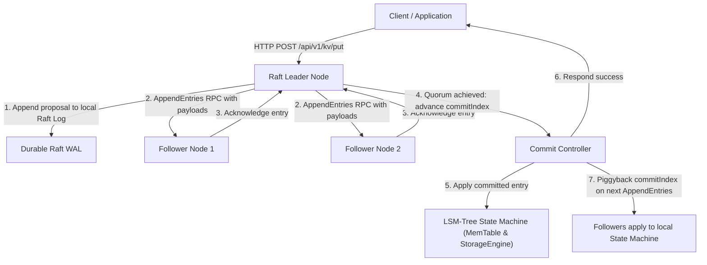

# Distributed Raft Consensus Engine — Production Design Specification

## 1. Executive Summary

AetherDB is currently a high-performance hybrid transactional and analytical storage engine prototype operating on single-node instances. This document provides the engineering architecture and blueprint for transitioning the experimental consensus prototype into a full, production-grade distributed consensus cluster based on the Raft algorithm (Ongaro & Ousterhout).

---

## 2. Current Implementation vs. Target Production Architecture

| Component | Current Prototype State | Target Production Raft Engine |
| :--- | :--- | :--- |
| **KV Write Path** | Direct write to local LSM-Tree | Write proposal routed to leader, appended to replicated log, quorum committed, applied to state machine |
| **State Persistence** | In-memory `RaftState` (`currentTerm`, `votedFor`, `log`) | Durable append-only Raft metadata file & WAL-based replicated log with fsync |
| **RPC Payloads** | Heartbeats and metadata exchange (`entryCount`) | Full batch entries payload serialization (`LogPayload` including keys, values, types) |
| **Consistency Validation** | Simplified `prevLogIndex` check | Strict inductive `prevLogIndex` / `prevLogTerm` validation with backwards conflict search |
| **Conflict Resolution** | Appends directly | Truncates conflicting uncommitted follower suffix before appending new entries |
| **Replication Tracking** | Simulated `matchIndex` | Leader tracks per-follower `nextIndex[]` and `matchIndex[]` vectors with backoff decrement |
| **Commit Advancement** | Heartbeat `leaderCommit` | Median `matchIndex` quorum calculation: leader advances commit only for entries from current term |
| **Cluster Membership** | Static config list | Dynamic joint-consensus configuration changes (single-server membership transitions) |
| **Log Compaction** | None (unbounded in-memory list) | Raft state-machine snapshots (`InstallSnapshot` RPC) coordinating with SSTable checkpoints |

---

## 3. Production Architecture Design

---

## 4. Key Mechanisms for Future Implementation

### 4.1 Persistent Raft Metadata
- Metadata file: `raft_state.meta` stored in `./data/<node>/raft/`.
- Written with atomic rename and fsync before responding to any RPC:
  - `currentTerm`: monotonic 64-bit integer.
  - `votedFor`: candidate ID granted vote in `currentTerm`, or `null`.

### 4.2 Replicated Log Storage
- Dedicated Raft WAL distinct from LSM-Tree WAL:
  - Each entry framed with term, index, CRC32, payload type (PUT/DELETE), key bytes, value bytes.
  - Efficient random access to entries by index `[firstIndex..lastIndex]`.
  - Fast suffix truncation when leader identifies conflicting follower branch.

### 4.3 Replicated Write Pipeline & Linearizable Reads
- **Write Pipeline**:
  1. Client sends write to node. If follower, node responds with `307 Temporary Redirect` pointing to known leader.
  2. Leader appends entry to its local Raft log.
  3. Leader dispatches `AppendEntries` RPC to all followers concurrently.
  4. Followers verify `prevLogIndex` and `prevLogTerm`. If mismatch, follower rejects. Leader decrements `nextIndex[peer]` and retries until match found.
  5. When a majority of nodes acknowledge the entry, leader advances `commitIndex`.
  6. Leader applies committed entry to `HybridStorageManager`.
  7. Client receives HTTP 200 acknowledgment.
- **Linearizable Reads**:
  - Read index protocol: leader verifies its leadership with a heartbeat quorum round before serving reads, ensuring stale partitioned leaders do not return stale data.

### 4.4 Snapshotting & Log Compaction
- Once Raft log exceeds configured size (e.g., 256MB), a snapshot of the LSM storage engine is taken.
- Entries prior to snapshot index are discarded from Raft log.
- Slow followers that lag behind the oldest log entry receive `InstallSnapshot` RPC to catch up directly from an SSTable checkpoint.

---

## 5. Summary

This design guarantees that when fully implemented, AetherDB will provide strict linearizable read/write semantics and Byzantine-free crash fault tolerance ($2f + 1$ node quorum) with zero data loss across network partitions.

